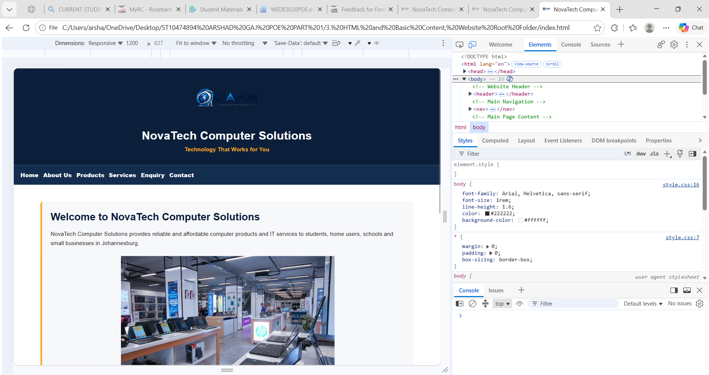
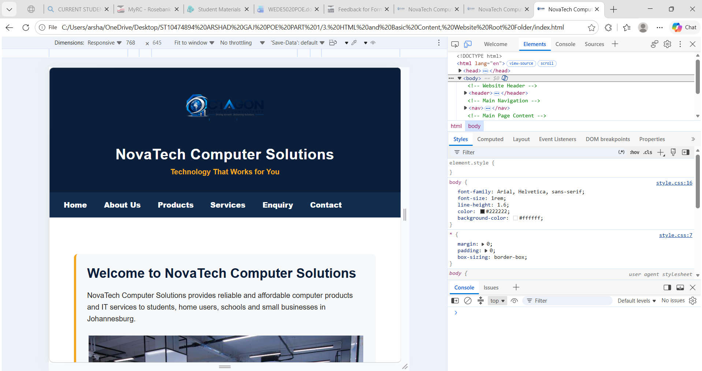
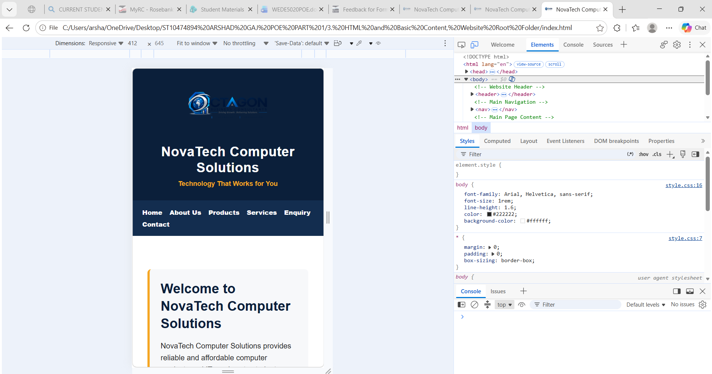

# NovaTech Computer Solutions Website

## Project Overview

NovaTech Computer Solutions is a fictional information technology business based in Johannesburg, Gauteng. This website was developed as part of the WEDE5020 Web Development (Introduction) Portfolio of Evidence.

The purpose of the website is to provide customers with clear and accessible information about NovaTech Computer Solutions, its computer products, IT services and methods of contacting the business.

## Live Website and Repository

- **Live website:** https://superlative-yeot-61f0c9.netlify.app/
- **GitHub repository:** https://github.com/arshad-gaj/ST10474894-ARSHAD-GAJ-POE-PART-2
- **Part 3 branch:** `poe-part3`
- **Hosting:** Netlify, connected to the `poe-part3` branch.
- **Publish directory:** `3. HTML and Basic Content, Website Root Folder`

All six website pages were checked in an InPrivate browser window
and were accessible without a Netlify login.

## Website Pages

The website consists of six interconnected HTML5 pages:

- **Home (`index.html`)** – introduces NovaTech Computer Solutions and provides an overview of the business.
- **About Us (`about.html`)** – provides information about the company, including its mission and vision.
- **Products (`products.html`)** – presents laptops, desktop computers, accessories and other computer products.
- **Services (`services.html`)** – describes the IT services offered, including computer repairs, software installation and technical support.
- **Enquiry (`enquiry.html`)** – provides a form that allows customers to submit enquiries about products and services.
- **Contact (`contact.html`)** – provides contact information, operating hours and other methods of communicating with the business.

## Project Structure

- `images/` – stores website images.
- `style.css` – the main stylesheet linked by all six pages.
- `js/script.js` – contains the FAQ accordion, interactive map,
  gallery lightbox, product search, form validation, enquiry AJAX
  submission and contact email preparation.
- `screenshots/` – stores responsive testing evidence.
- The six HTML pages are stored in the website root folder.

## Technologies Used

The project currently uses:

- HTML5
- CSS3
- Semantic HTML elements
- HTML navigation and hyperlinks
- Responsive images
- CSS Flexbox
- CSS media queries
- HTML forms and required-field validation
- Git and GitHub for version control
- JavaScript and DOM manipulation
- Leaflet.js for the interactive map
- Fetch API for AJAX enquiry submission
- Netlify Forms for receiving enquiries
- Netlify for website hosting and deployment

## POE Part 3 – Functionality and SEO

- Added an FAQ accordion to the Services page.
- Added a Leaflet map showing the Johannesburg service area.
- Added a product gallery lightbox with captions, previous/next
  controls, overlay closing and keyboard support.
- Added product search with keyword filtering, a reset button
  and a no-results message.
- Added unique page titles, meta keywords and meta descriptions
  to all six pages.
- Audited image alt text and added a default lightbox description.
- Improved enquiry form controls, instructions and validation.
- Added enquiry responses based on the selected enquiry type.
- Connected the enquiry form to Netlify Forms using AJAX.
  Submission feedback appears without reloading the page.
  Failed submissions preserve the entered details.
- Added a separate contact form with validation and email
  preparation using the visitor's email application.
- Deployed the website publicly through Netlify from `poe-part3`.

### Form Behaviour

The enquiry form sends submissions to the Netlify Forms dashboard.
Successful delivery requires the deployed website; opening the
HTML file directly on a laptop does not provide this service.

The contact form prepares an email containing the validated
details. The visitor must review and send it using a configured
email application. The website does not send this email automatically.

NovaTech is a fictional business created for this assignment.

## Development and Testing

The website was developed using Visual Studio Code and tested in a web browser. Testing includes checking that:

- All six HTML pages open correctly.
- Navigation links connect to the correct pages.
- Images load correctly.
- Website content displays correctly.
- The Enquiry form accepts user input.
- Required-field validation prevents incomplete form submission.
- Desktop, tablet and mobile layouts respond correctly at different screen sizes.

### Part 3 Testing Results

- Tested the FAQ accordion, map, product lightbox and product
  search on desktop and mobile layouts.
- Checked enquiry and contact controls, keyboard navigation,
  dropdown options and Clear Form buttons.
- Tested empty required fields, invalid email addresses,
  whitespace-only names and messages, and short messages.
- Tested the optional enquiry phone field with blank, valid
  South African and invalid phone numbers.
- Checked all five enquiry types for relevant responses.
- Tested contact email preparation, including the recipient,
  subject, sender details, message, special characters and line
  breaks. Email drafts were inspected without sending.
- Tested local enquiry submission failure: an error message
  appeared, entered details were retained and controls became
  available again.
- Submitted a desktop product enquiry through the live website
  and confirmed its receipt in Netlify Forms, including the
  ampersand in the message.
- Submitted a service enquiry at a 412px mobile viewport and
  confirmed its receipt in Netlify Forms.
- Checked that AJAX responses appeared without a page reload
  and that feedback fitted the mobile layout.
- Verified that all six deployed pages opened with images and
  styling in an InPrivate window without a Netlify login.

Mobile checks used browser device emulation.

## Version Control

GitHub is used to store the project and maintain a record of its development. Commits are used to document significant changes made to the website during the development process.

## Author

**Student:** Arshad Gaj  
**Student Number:** ST10474894  
**Module:** WEDE5020 – Web Development (Introduction)  
**Portfolio:** POE Part 3 
**Year:** 2026

## POE Part 2 – CSS Styling and Responsive Design

Part 2 of the project focuses on improving the visual design and responsiveness of the NovaTech Computer Solutions website. An external CSS stylesheet was introduced and applied consistently across all six HTML pages.

The website uses a dark blue, white and orange colour scheme to maintain a professional technology-focused appearance. CSS was used to improve typography, spacing, navigation, page layout, images, forms and other visual elements.

Responsive design was implemented to allow the website to adapt to different screen sizes. Media queries were used for desktop, tablet and mobile layouts. Flexible layouts and responsive images were also implemented to improve the website's usability across different devices.

The website was tested using browser developer tools at different viewport sizes to confirm that the content, navigation, images and page layouts respond correctly.

## Changelog

### Part 3 Development Changes

#### Interactive Features
- Added a responsive FAQ accordion to the Services page.
- Added a Leaflet map showing the Johannesburg service area
  and corrected the map tile-loading issue.
- Added a product image lightbox with captions, previous/next
  navigation, keyboard controls and mobile styling.
- Added keyword-based product filtering, reset functionality
  and a no-results message (`4944513`).

#### Search Engine Optimisation
- Added unique descriptive titles to all six pages (`916de7b`).
- Added page-specific meta keywords (`5573a2b`).
- Added page-specific meta descriptions (`2660e7a`).
- Audited image alt text and added a default description for
  the lightbox image (`7865500`).

#### Enquiry Form
- Improved form controls, autofill attributes, input limits,
  help text and the accessible feedback area (`bfb7d22`).
- Added JavaScript validation and clear error feedback,
  including optional phone-number validation (`1c6af00`).
- Added responses tailored to the selected enquiry type
  and responsive feedback styling (`17ad8a4`).
- Connected the form to Netlify Forms using AJAX, with
  submission progress, duplicate-click protection and
  failure recovery (`aacc7fe`).
- Confirmed desktop and mobile test submissions arrived
  in the Netlify Forms dashboard.

#### Contact Form
- Added a separate accessible contact form (`a526a27`).
- Added validation and error feedback (`6997c95`).
- Added email preparation containing the validated sender
  details, message type and full message (`9eb3f90`).
- Tested email draft contents and special-character handling.

#### Deployment and Documentation
- Connected Netlify deployment to the `poe-part3` branch.
- Configured the website root folder as the publish directory.
- Enabled Netlify form detection.
- Enabled public access and checked all six pages in an
  InPrivate browser window.
- Updated the README with the live URL, technologies,
  Part 3 features, form behaviour and testing results.
  
### Part 1 Feedback Corrections

- **Goals and Objectives:** Added a separate Objectives section to the project documentation. The original project goals were retained, while clear objectives were added to explain what the NovaTech website is intended to achieve.

- **Current Analysis:** Expanded the current analysis to explain NovaTech's existing situation, limitations caused by not having a dedicated website, customer communication challenges, online visibility and how the proposed website addresses these problems.

- **Proposed Website Features and Functionality:** Expanded the proposed features and functionality to provide clearer descriptions of the six website pages and explain how each page supports the needs of NovaTech and its customers.

- **Design Aesthetic:** Improved the design planning by providing a clearer and more consistent visual direction for the website, including the dark blue, white and orange colour scheme, typography, spacing and overall technology-focused appearance.

- **Technical Requirements:** Expanded the technical requirements to provide clearer information about the technologies, software, browser requirements, file structure and resources required to develop and maintain the website.

- **Timeline:** Revised the project timeline to provide a clearer development schedule and more realistic allocation of tasks across the different stages of the website project.

- **Budget:** Expanded the proposed budget to provide clearer estimated costs and explanations for the resources required for the website.

- **Content Research and Sourcing:** Improved the organisation and detail of the content research and sourcing information used to support the website content.

- **Sitemap:** Improved the sitemap documentation to provide a clearer representation of the website structure and relationships between the six website pages.

- **GitHub Commits:** Improved commit descriptions so that changes made during development can be identified more clearly.

- **README and Changelog:** Expanded the README with additional project information and introduced a more detailed changelog to document development changes and Part 1 feedback corrections.

### Part 2 Development Changes

- Created and linked an external CSS stylesheet to provide consistent styling across the website.
- Added a CSS reset to improve consistency between browsers.
- Applied consistent typography, colours, margins, padding and spacing.
- Used Flexbox to improve website layout and navigation.
- Added visual styling including backgrounds, borders and other interface improvements.
- Added interactive styling for navigation links and other interactive elements.
- Implemented responsive layouts using CSS media queries.
- Added desktop, tablet and mobile layout adjustments.
- Used relative and flexible sizing where appropriate to improve responsiveness.
- Implemented responsive images using `srcset` and `sizes`.
- Tested the website at desktop, tablet and mobile viewport sizes using browser developer tools.
- Checked all six pages to confirm that navigation, content, images and layouts display correctly at different screen sizes.

### Part 2 Development

#### Part 1 Feedback Corrections
- Added clear and measurable objectives to the project proposal because the original proposal included goals but did not clearly identify the project objectives.
- Expanded the current analysis to provide a more detailed explanation of NovaTech Computer Solutions' current situation, communication methods, limitations and the need for a dedicated website.
- Expanded the proposed website features and functionality to clearly explain the purpose and functionality of the Home, About Us, Products, Services, Enquiry and Contact pages.
- Improved the design aesthetic description by providing clearer information about the colour scheme, typography, layout and overall visual consistency of the website.
- Expanded the technical requirements to provide clearer information about the software, technologies, browser testing and development requirements.
- Improved the project timeline by providing clearer development activities and realistic time allocation.
- Expanded the proposed budget to provide clearer cost estimates and justification.
- Improved the organisation and detail of the content research and sourcing information.
- Improved the sitemap information to provide a clearer representation of the website structure.

#### CSS Styling
- Created an external CSS stylesheet named `style.css`.
- Linked the external stylesheet to all six HTML pages.
- Added a CSS reset to provide consistent browser styling.
- Added consistent typography, spacing, colours, borders and layout styling.
- Used the NovaTech dark blue, white and orange colour scheme throughout the website.
- Added interactive hover, focus and active states for navigation links and form controls.

#### Responsive Design
- Added responsive styling for desktop, tablet and mobile screen sizes.
- Used media queries to adapt the website layout at different breakpoints.
- Used relative sizing and responsive layouts to improve usability on different devices.
- Added responsive image handling using `srcset` and `sizes`.
- Tested the website using browser developer tools at desktop, tablet and mobile widths.
- Added screenshot evidence of responsive testing.

#### Responsive Testing Evidence

**Desktop - 1200 px**

**Tablet - 768 px**

**Mobile - 412 px**

 